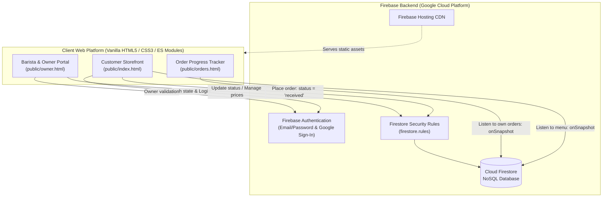

# CafeLive Hyderabad ☕🇮🇳

[](https://cafelive-e1b7f.web.app/)
[](https://firebase.google.com/docs/firestore)
[](https://developer.mozilla.org/en-US/docs/Web/JavaScript/Guide/Modules)
[](public/css/style.css)
[]()

**CafeLive Hyderabad** is a production-quality, real-time cafe ordering and kitchen management platform tailored for the iconic cafe culture of Hyderabad (serving Irani Chai, Osmania Biscuits, Keema Luqmi, and artisanal bakery specialties with authentic Indian Rupee `₹` pricing).

Built purely with **plain HTML5, modern CSS3 (custom design system tokens), and vanilla JavaScript (native ES modules)** using the official **Firebase Web SDK v10 (modular via Google CDN)**.

> **Zero build steps. Zero bundlers. No Webpack, Vite, or Babel. No React/Vue/Angular overhead. 100% standard web platform.**

---

## 🔗 Live Application Links

- **Customer Storefront & Ordering:** [https://cafelive-e1b7f.web.app/](https://cafelive-e1b7f.web.app/)
- **Live Order Tracker:** [https://cafelive-e1b7f.web.app/orders.html](https://cafelive-e1b7f.web.app/orders.html)
- **Barista & Kitchen Owner Portal:** [https://cafelive-e1b7f.web.app/owner.html](https://cafelive-e1b7f.web.app/owner.html)

---

## ✨ Feature Highlights

### ☕ 1. Customer Storefront (`public/index.html`)
- **Warm Hyderabad Aesthetic:** Custom color tokens inspired by Irani Chai culture — rich cream surfaces, royal saffron highlights, deep roasted-bean brown headings, and terracotta accents.
- **Editorial Typography:** Harmonious pair of *Playfair Display* (classic serif headers) and *Plus Jakarta Sans* (clean geometric body).
- **Real-Time Menu Catalog:** Synchronized live with Cloud Firestore collection `menu`. Any price change or stock update reflects on customer screens instantaneously without page reload.
- **Multi-Tier Asset Fallback:** Bulletproof image loading sequence:
  $$\text{Real HD Photo (.jpg)} \longrightarrow \text{Custom Vector Illustration (.svg)} \longrightarrow \text{Lightweight Placeholder (.svg)}$$
- **Promotional Pricing Engine:** Struck-through original price, highlighted promotional price, and high-visibility percentage discount badges (e.g. `10% OFF`).
- **Interactive Cart Drawer:** Mobile-first slide-up drawer with quantity controls (`+` / `−`), single/plural item labels (`1 item` vs `2 items`), and automatic total calculation.
- **Customer Nickname Callouts:** Captures customer nickname during checkout so baristas can call out names in a bustling cafe.

### 📋 2. Real-Time Order Tracking (`public/orders.html`)
- **Interactive 3-Stage Progress Stepper:** Visual progress bar tracking order states:
  $$\text{Order Received} \longrightarrow \text{Preparing in Kitchen 👨‍🍳} \longrightarrow \text{Ready for Pickup! ☕}$$
- **Zero Composite Index Dependency:** Real-time query filtered by `userId` and sorted chronologically in client-side JavaScript (`createdAt` descending), eliminating the need for Firestore composite indexes.
- **Order Summary:** Displays itemized breakdown, final discounted price per line, and grand total in `₹`.

### 👨‍🍳 3. Barista & Kitchen Owner Portal (`public/owner.html`)
- **Strict Role-Based Access Control (RBAC):** Portal guarded by Firestore security check against collection `/owners/{uid}`. Unauthorized users are blocked with clear feedback.
- **Live Kanban Order Board:** 3 dedicated visual columns (**Received**, **Preparing**, **Ready for Pickup**) with real-time counters and incoming order pulse animation.
- **Barista Counter Badges:** High-contrast customer nickname display on every card for swift kitchen shouting.
- **1-Click Order Status Transitions:** Smooth card advancement between columns via strict Firestore security rule operations.
- **Owner Pricing & Catalog Tools:**
  - **Quick Price Adjustments:** One-click `+₹5` and `−₹5` buttons plus an exact price number input with immediate validation (`price > 0`).
  - **Promotional Discounts (0–90%):** Set percentage discounts per item or turn them off with one click, preserving original base prices.
  - **Bulk Category Actions:** Apply discounts across entire categories (e.g., *10% off all Snacks*) or clear all discounts across the catalog.
  - **No-Popup Inline Confirmations:** Clean, accessible inline UI prompts displaying exact affected item counts before executing bulk changes.
  - **Price Audit History:** Real-time timestamp note showing the exact last changed time for each item's price.
  - **Live Photo Preview & Preset Launcher:** 1-click presets for authentic Hyderabad cafe items with live card preview before publishing.
  - **Non-Destructive Catalog Seeder:** Safely resets or adds the 16 authentic Hyderabad items by name without deleting custom items.

---

## 🏗️ Architecture & Data Flow



---

## 🗄️ Firestore Data Model

### 1. `menu/{itemId}`
Stores menu catalog items managed by cafe owners:
| Field | Type | Description |
| :--- | :--- | :--- |
| `name` | `string` | Display name (e.g. `"Special Hyderabadi Irani Chai"`) |
| `price` | `number` | Base price in INR (must be `> 0`) |
| `discountPercent` | `number` | Optional discount percentage (`0` to `90`) |
| `category` | `string` | Categorization (`"Beverages"`, `"Bakery"`, `"Snacks"`, `"Food"`, `"Dessert"`) |
| `available` | `boolean` | Availability toggle (`true` for in stock, `false` for sold out) |
| `image` | `string` | Image path or URL (e.g. `"images/irani-chai.jpg"`) |
| `priceUpdatedAt` | `timestamp` | Server timestamp of last price or discount change |

### 2. `orders/{orderId}`
Tracks customer orders from placement through fulfillment:
| Field | Type | Description |
| :--- | :--- | :--- |
| `userId` | `string` | UID of authenticated customer |
| `customerName` | `string` | Nickname for barista counter callout |
| `userEmail` | `string` | Customer contact email |
| `items` | `array` | List of items: `[{ name: string, qty: number, price: number }]` (final price saved) |
| `total` | `number` | Grand total in INR (`₹`) |
| `status` | `string` | State: `"received"` $\to$ `"preparing"` $\to$ `"ready"` $\to$ `"completed"` $\to$ `"cancelled"` |
| `createdAt` | `timestamp` | Server timestamp (`FieldValue.serverTimestamp()`) |

### 3. `owners/{uid}`
Marker collection for authorization:
| Field | Type | Description |
| :--- | :--- | :--- |
| *Document ID* | `string` | Auth UID of authorized owner/staff (presence grants owner privileges) |

---

## 🛡️ Security Architecture (`firestore.rules`)

The security rules enforce strict document schema validation, ownership guards, and role-based permissions:

```javascript
rules_version = '2';
service cloud.firestore {
  match /databases/{database}/documents {

    function isSignedIn() {
      return request.auth != null;
    }

    function isOwner() {
      return isSignedIn() && exists(/databases/$(database)/documents/owners/$(request.auth.uid));
    }

    // Public can view menu; only verified owners can write
    match /menu/{itemId} {
      allow read: if true;
      allow write: if isOwner() &&
                   request.resource.data.name is string &&
                   request.resource.data.price is number &&
                   request.resource.data.price > 0 &&
                   (!('discountPercent' in request.resource.data) ||
                    (request.resource.data.discountPercent is number &&
                     request.resource.data.discountPercent >= 0 &&
                     request.resource.data.discountPercent <= 90));
    }

    // Owners can verify their own marker document; no client writes allowed
    match /owners/{uid} {
      allow read: if isSignedIn() && request.auth.uid == uid;
      allow write: if false;
    }

    // Orders: creation requires initial 'received' status; updates restricted to owners
    match /orders/{orderId} {
      allow create: if isSignedIn() &&
                    request.resource.data.userId == request.auth.uid &&
                    request.resource.data.status == "received";

      allow read: if isSignedIn() &&
                  (resource.data.userId == request.auth.uid || isOwner());

      allow update: if isOwner() &&
                    request.resource.data.diff(resource.data).affectedKeys().hasOnly(['status']) &&
                    request.resource.data.status in ['received', 'preparing', 'ready', 'completed', 'cancelled'];

      allow delete: if false;
    }
  }
}
```

---

## 📁 Project Directory Structure

```plaintext
cafelife/
├── .firebaserc                # Firebase active project configuration
├── firebase.json              # Firebase Hosting & Firestore deploy settings
├── firestore.rules            # Production Firestore security rules
├── firestore.indexes.json     # Firestore index definitions
├── README.md                  # Complete project documentation
└── public/                    # Production web distribution directory
    ├── 404.html               # Custom 404 error page
    ├── index.html             # Customer storefront, live menu & floating cart
    ├── orders.html            # Customer order history & live progress stepper
    ├── owner.html             # Barista Kanban board & owner price management
    ├── css/
    │   └── style.css          # Design system tokens, components, responsive styles
    ├── js/
    │   ├── firebase.js        # Firebase app initialization & modular CDN re-exports
    │   ├── auth.js            # Auth workflows, Google Sign-In & header pill updates
    │   ├── menu.js            # Menu listener, pricing logic, discount tools & fallbacks
    │   ├── orders.js          # Order placement, customer orders listener & formatting
    │   └── owner.js           # Owner checks, Kanban subscriptions & status dispatch
    └── images/
        ├── hero.png           # Hero banner artwork
        ├── logo.png           # Brand logo
        ├── irani-chai.jpg     # Authentic Hyderabad menu photography (.jpg)
        ├── zafrani-chai.jpg
        ├── filter-coffee.jpg
        ├── cold-coffee.jpg
        ├── badam-milk.jpg
        ├── osmania.jpg
        ├── bun-maska.jpg
        ├── dilkhush.jpg
        ├── plum-cake.jpg
        ├── luqmi.jpg
        ├── samosa.jpg
        ├── sandwich.jpg
        ├── french-fries.jpg
        ├── *.svg              # Custom vector illustration fallbacks
        └── placeholder.svg    # Universal fallback asset
```

---

## 🛠️ Local Development & Testing

Since this project requires zero compilation, you can run it immediately with any static HTTP server.

### 1. Clone & Navigate
```bash
git clone https://github.com/dharmanayuvaraju/Cafelife.git
cd Cafelife
```

### 2. Start Local Server
Run with Python:
```bash
python -m http.server -d public 8000
```
Or with Node (`npx serve`):
```bash
npx serve public -l 8000
```

### 3. Open in Browser
Visit `http://localhost:8000` to test customer ordering, or `http://localhost:8000/owner.html` for kitchen management.

---

## 👨‍💼 How to Provision an Owner Account

To grant an account barista/owner administrative access:
1. Open the [Firebase Console](https://console.firebase.google.com/) for your project (`cafelife-e1b7f`).
2. Navigate to **Authentication ➔ Users** and copy the user's **UID**.
3. Navigate to **Firestore Database ➔ Data**.
4. In the `owners` collection, create a document where **Document ID = `<User UID>`** (fields can remain empty).
5. The account now has immediate access to the Barista Kanban Board and Menu Catalog tools.

---

## 🚀 Deploying to Firebase

Deploy rules and hosting updates in one command:
```bash
# 1. Login to Firebase CLI
firebase login

# 2. Deploy Firestore Rules and Hosting
firebase deploy --only firestore:rules,hosting
```

Or deploy components independently:
```bash
# Deploy only security rules
firebase deploy --only firestore:rules

# Deploy only hosting assets
firebase deploy --only hosting
```

---

## 📄 License

This project is open-source and available under the [MIT License](LICENSE). Made with ❤️ for the love of Hyderabad Chai!
